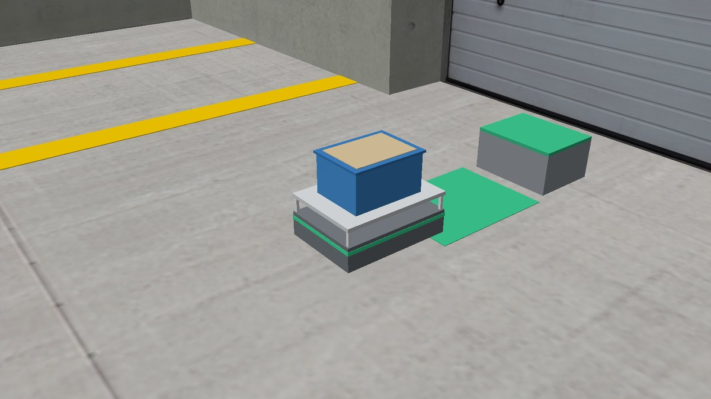
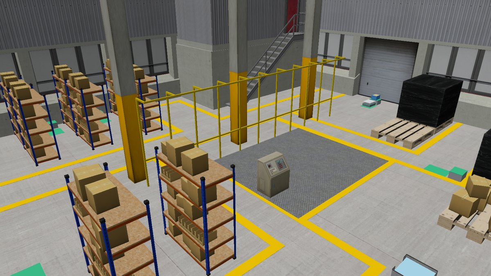
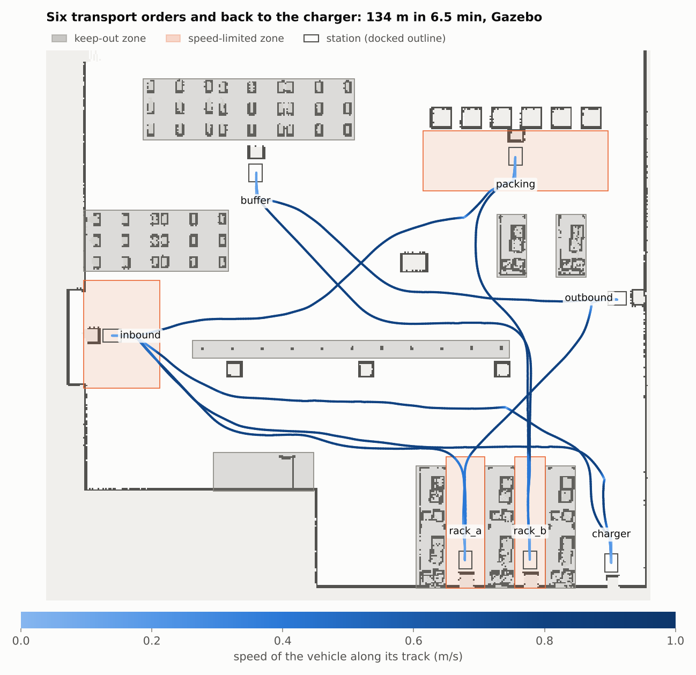
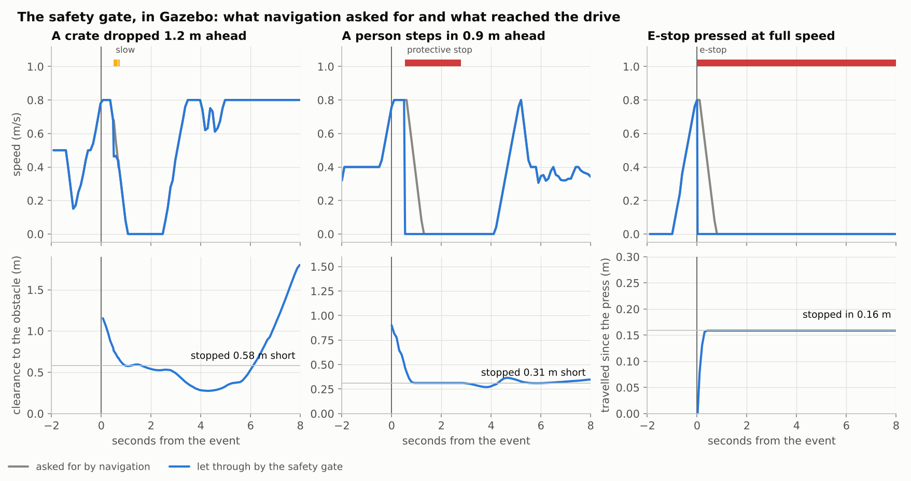
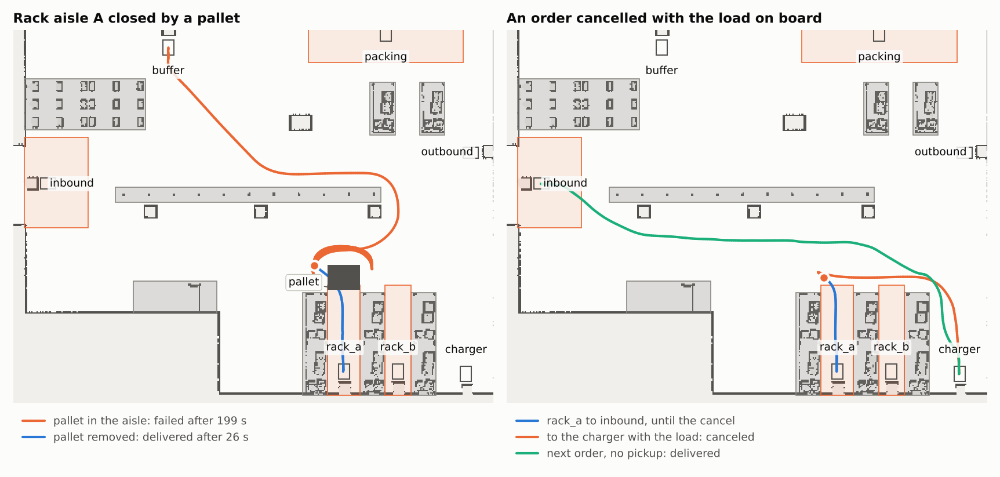
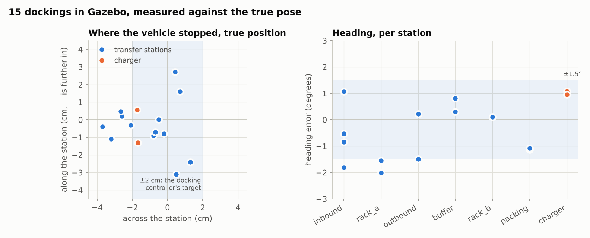
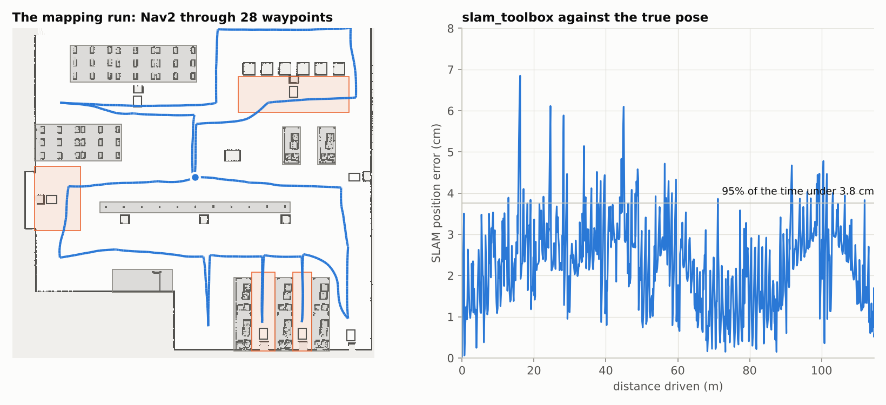

# Warehouse AGV

A small automated guided vehicle that carries totes around a warehouse. It maps the hall with its LiDAR (slam_toolbox), localises on that map (AMCL), drives with Nav2, docks at transfer stations with its own controller, and passes every velocity command through a LiDAR safety gate. ROS 2 Jazzy, Python, Gazebo Harmonic.

Licensed under the [BSD 3-Clause License](LICENSE). Built on [warehouse_simulation_toolkit](https://github.com/wh200720041/warehouse_simulation_toolkit) by Wang Han (BSD 3-Clause) and on workcell models from the ARIAC competition (Apache 2.0): [THIRD_PARTY_NOTICES.md](THIRD_PARTY_NOTICES.md) says what came from where. Tested in simulation only: read the [safety notice](#safety-notice) before putting it on a vehicle.

An order is one action goal: *carry the tote standing at `inbound` to `rack_a`*. The vehicle checks the order (both stations exist, the planner finds a route for every leg, the battery covers them all), backs out of the station it is docked at, drives to the pickup with Nav2, docks, takes the tote on board, drives to the dropoff, docks, sets the tote down, and goes back to its charger if asked. Every velocity command, from Nav2, from the docking controller or from an operator, reaches the drive only through the safety gate: speed-dependent protective and warning fields measured on the scan, an e-stop that latches, and watchdogs on every input. The warehouse is a Gazebo world generated from the same site file the vehicle navigates by, and the map it localises on is one it made itself.

## Results

All of these are simulated. In Gazebo the vehicle's LiDAR (GPU ray-traced), IMU and differential drive are simulated and the whole stack runs on top, as it would on the vehicle; the numbers come from the scripted run of the scenarios listed under [Verified in Gazebo](#verified-in-gazebo). The scripts that drove that run and drew these figures are in [tools/](tools).

 

*Left: the vehicle backing out of `inbound` with the tote it has just taken on board; the empty stand behind it. Right: the hall from its north-east corner: shelving, the yellow frame across the hall, the stairs, and the roll-up door by `inbound`.*

<picture>
  <source media="(prefers-color-scheme: dark)" srcset="docs/images/tour-dark.png">
  
</picture>

<picture>
  <source media="(prefers-color-scheme: dark)" srcset="docs/images/safety-stops-dark.png">
  
</picture>

<picture>
  <source media="(prefers-color-scheme: dark)" srcset="docs/images/blocked-and-cancel-dark.png">
  
</picture>

<picture>
  <source media="(prefers-color-scheme: dark)" srcset="docs/images/docking-dark.png">
  
</picture>

<picture>
  <source media="(prefers-color-scheme: dark)" srcset="docs/images/slam-dark.png">
  
</picture>

## Architecture

```
Transport goal -> mission_node -> Mission (agv_core)
   (action)                        check:  stations, a planned route for every leg, battery
                                   travel: back out of the station, Nav2 to the approach pose
                                   dock:   DockingController, the last 0.8 m, own commands
                                   load:   load/command, then wait for load/state to agree
                                   guard:  e-stop, safety faults, lost position, blocked,
                                           battery, a deadline on every step
          navigate_to_pose |                 cmd_vel_dock |                load/command |
                           v                              |                             v
   Nav2  SmacPlanner2D on the map, keep-out and speed zones   load handler: sim_agv (Gazebo),
         rotation shim + regulated pure pursuit               fake_base (dry run), or the
         clear / wait / back-up recoveries                    vehicle's own
         velocity smoother                                    |
                           | cmd_vel_smoothed                 |      cmd_vel_manual (operator)
                           v                                  v      |
   safety_node -> SafetyMonitor (agv_core)  <-----------------+------+
                  fields from /scan along the requested motion, e-stop latch, watchdogs
                           | cmd_vel
                           v
   drive: Gazebo DiffDrive | fake_base | the vehicle

   scan_raw -> scan_filter -> scan          wheel odometry + IMU -> ekf_node -> odom
   AMCL on the site's map -> map -> odom    (slam_toolbox instead, while mapping)
```

The decisions live in `agv_core`, a plain Python package with no ROS in it: the mission state machine, the safety gate, the docking controller, the battery model, the site file, occupancy grids and the zone masks. The nodes only translate. Whole orders, failure paths included, are tested far faster than real time against a kinematic vehicle with a simulated scanner in a simulated hall, and the same nodes then run unchanged in Gazebo.

## Repository layout

```
ros2_ws/src/
  agv_core/         plain Python, no ROS: geometry, the site file, occupancy grids, zone
                    masks, the vehicle's dimensions, SafetyMonitor, DockingController, the
                    battery model, the Mission state machine, a kinematic vehicle with a
                    ray-cast scanner for the tests
  agv_interfaces/   Transport action, MissionStatus / SafetyStatus / LoadStatus messages,
                    LoadCommand service
  agv_robot/        mission_node, safety_node, fake_base (the dry run's vehicle), launch
                    files, Nav2 / EKF / SLAM / scan filter configs, the behaviour tree, the
                    URDF, and the warehouse site: site.yaml, the map, the generated masks
  agv_gazebo/       the Gazebo world (generated from the site file), the tote, the bridge,
                    sim_agv (load handler and battery), sim.launch.py
tools/              scenario runner, recorder and figure script behind the Results
.github/workflows/ci.yml   build and every test in ros:jazzy
```

## The vehicle

| | |
|---|---|
| Outline | 0.60 x 0.44 m, load deck 0.26 m above the floor |
| Drive | differential, centred (turns on the spot), wheels 0.15 m across, 0.29 m apart |
| Scanner | 360°, 720 beams, 10 Hz, 0.08 to 16 m, 1 cm noise; in a slot under the deck, at the vehicle's centre, beam plane 0.20 m above the floor; the four posts that carry the deck are filtered out of its scan |
| IMU | 100 Hz, gyro used by the EKF |
| Limits | 1.0 m/s forward, 0.3 m/s reversing, 1.5 rad/s; accelerates at 0.8 m/s² and brakes at 1.2 m/s² in normal driving, at 2.5 m/s² in a protective stop |

The numbers live in [`agv_core/vehicle.py`](ros2_ws/src/agv_core/agv_core/vehicle.py). The URDF, Nav2's footprint, the speed limits of the velocity smoother and the safety gate, and the scan filter that takes the deck posts out of the scan each have to say them again in their own format; tests compare all of them with that file.

## The site file

Everything that is particular to one warehouse is in [`sites/warehouse/site.yaml`](ros2_ws/src/agv_robot/sites/warehouse/site.yaml): the stations and the zones, in the map frame.

```yaml
stations:
  charger:  {kind: charger,  pose: [8.7, -8.85, -90]}   # x, y, heading the vehicle docks with
  inbound:  {kind: transfer, pose: [-8.0, -1.25, 180]}
  ...
zones:
  - name: rack_5
    kind: keepout                      # no part of the vehicle in here
    polygon: [[2.17, -9.70], [3.17, -9.70], [3.17, -5.60], [2.17, -5.60]]
  - name: rack_aisle_a
    kind: speed
    limit: 0.4                         # m/s
    polygon: [[3.17, -9.70], [4.47, -9.70], [4.47, -5.30], [3.17, -5.30]]
```

A station's pose is where the vehicle stands when docked there, facing the transfer stand (or the charger's contacts). Nav2 takes the vehicle to the approach pose 0.8 m straight back from it, and the docking controller drives the rest: on gentle curves only, slowing to a crawl, aiming for 2 cm off the centre line and 1.5° off the station's heading.

Keep-out zones exist because a scanner sees one plane. At 0.20 m above the floor a pallet is its nine feet and a rack is its posts and whatever stands on its bottom shelf: the map shows gaps there that the vehicle would fit through and the real thing does not have. So storage is fenced off in the site file, as it would be on a real site.

The site file is checked against the vehicle and the map before anything uses it: a station inside a wall, an approach pose without room to turn on the spot, a docking run that scrapes a rack, a docked vehicle reaching into a keep-out zone or a zone that misses the map are all refused with the reason. From the site file and the map, [`generate_masks.py`](ros2_ws/src/agv_robot/scripts/generate_masks.py) draws the images Nav2's costmap filters read, and [`generate_world.py`](ros2_ws/src/agv_gazebo/scripts/generate_world.py) writes the Gazebo world with a stand at every station. The test suite regenerates both and fails if either was not redone after an edit.

Nav2 applies costmap filters after inflation, so a keep-out cell is never inflated, and a footprint that touches a lethal cell is stuck for good: the controller and the back-up recovery both refuse every motion from such a pose. Each costmap therefore gets its own drawing of the zones ([`agv_core/masks.py`](ros2_ws/src/agv_core/agv_core/masks.py)):

- **The planner** sees each zone with a band round it as wide as the vehicle's turning radius, expensive but not closed, fading out over a further 25 cm. Routes keep far enough from a zone that the body stays out of it while turning or cutting a corner. Between two zones they keep to the middle. A vehicle that has strayed into the band can still plan its way out.
- **The controller** sees each zone lethal only from 10 cm inside its edge. It stops the vehicle before that, and a vehicle that grazed a zone (it stopped late, or its position estimate moved) can drive out again instead of being stuck there for good.

## Setup

ROS 2 Jazzy with Nav2, slam_toolbox, robot_localization, laser_filters and the Gazebo Harmonic bridge. Two ways to get them:

**Ubuntu 24.04, from the ROS apt repository**, once ROS 2 Jazzy itself is installed:

```bash
source /opt/ros/jazzy/setup.bash
sudo rosdep init; rosdep update          # once per machine
rosdep install --from-paths ros2_ws/src --ignore-src -y
```

**Any Linux, with conda ([RoboStack](https://robostack.github.io))**, which is how this was developed:

```bash
mamba create -n ros -c robostack-jazzy -c conda-forge \
  ros-jazzy-desktop ros-jazzy-navigation2 ros-jazzy-slam-toolbox ros-jazzy-robot-localization \
  ros-jazzy-laser-filters ros-jazzy-ros-gz ros-jazzy-xacro ros-jazzy-teleop-twist-keyboard \
  ros-jazzy-rosidl-default-generators ros-jazzy-ament-cmake-pytest ros-jazzy-ament-lint-common \
  ros-jazzy-launch-testing-ament-cmake colcon-common-extensions compilers cmake make ninja \
  pkg-config pytest pyyaml numpy
conda activate ros
```

Gazebo is only needed for the simulation; the build, the tests and the dry run do without it.

## Build and test

```bash
cd ros2_ws
colcon build
colcon test && colcon test-result --verbose
```

418 tests, all of them run by CI, plus flake8 on the three Python packages. What they cover:

- **agv_core**, the decisions, in plain Python:
  - **the safety gate** (59 tests): fields that grow with speed and are sized for what the vehicle was told when odometry lags; exact contact along an arc, including the outer front corner swinging wide and the inside of a turn arriving sooner; turning on the spot; a protective stop that holds until the field has been clear for the restart delay, and starts the wait again if someone comes back; stray returns and returns closer than the scanner can measure; docking up to a stand that driving must keep away from; scan, odometry and command watchdogs; the e-stop latch and its reset; manual control outranking navigation and still gated.
  - **the mission** (90 tests): every step of an order and every way it can fail. Orders that make no sense, no route, too little battery, a route check that never answers; navigation giving up once and every time, never taking the goal, never arriving, arriving somewhere else, or driving round without coming any nearer; missed docks and docks that never work; load handlers that refuse, jam, fault, lose the load or report a load from nowhere; the e-stop, safety faults, a lost position and an operator holding an order; cancelling, with and without the load; the battery policy before, during and after an order.
  - **docking** (64 tests), from wherever Nav2 leaves the vehicle, with a lagging drive, at any station heading; the runs it refuses and the ends it counts as failed.
  - **closed-loop scenarios** (20 tests): the mission, the safety gate and the docking controller on a kinematic vehicle whose scanner casts rays through a simulated hall, with pallets, people and blocked aisles: nothing is hit, routes stay out of keep-out zones and within speed limits, and every order ends the way it should.
  - the site file, occupancy grids (they read and write maps as Nav2's map_server does), zone masks, geometry, the battery model and the simulated vehicle and scanner the scenarios use.
- **agv_robot**: the shipped site loads, fits its map, has current masks and every station can reach every other; the URDF, Nav2's footprints and speed limits, the safety gate's limits and the scan filter agree with `agv_core/vehicle.py`. Two launch tests start the whole stack (AMCL, Nav2, the safety gate, the mission) on `fake_base` and drive orders through it in real time: a delivery and back to the charger; refused orders, an e-stop held and reset, a box put in the way, a cancelled order.
- **agv_gazebo**: the committed world is what the site file gives, its stands are where the stations are, and the systems the vehicle needs are loaded.

The three Python packages also run flake8 with ROS 2's settings.

## Run

### Dry run (no Gazebo)

The whole stack against `fake_base`, a kinematic stand-in for the vehicle whose scanner casts rays through the site's map. AMCL, Nav2, the safety gate and the mission run exactly as on the vehicle, in real time, without a GPU:

```bash
source ros2_ws/install/setup.bash
ros2 launch agv_robot dry_run.launch.py
ros2 action send_goal --feedback /transport agv_interfaces/action/Transport \
  "{pickup: inbound, dropoff: packing, return_to_charger: true}"
```

What can be arranged, all as launch arguments: `start:=rack_a` (a station, or `"x,y,heading_deg"`), `obstacles:="box 6.5 0 2.9 1.2; disc 2 3 0.3"` (things the map does not have; change them while it runs on `/sim/obstacles`), `loaded:=true`, `battery:=0.3`, `load_rejections:=2` and `load_stuck:=true` (a load handler that refuses or jams), `charger_dead:=true`.

### Simulation (Gazebo Harmonic)

```bash
ros2 launch agv_gazebo sim.launch.py              # gui:=true opens Gazebo's window
ros2 action send_goal --feedback /transport agv_interfaces/action/Transport \
  "{pickup: inbound, dropoff: rack_a}"
```

The vehicle starts docked at the charger (`start:=`), the tote on the stand at `inbound` (`load_at:=`). Headless, the default, still renders: the LiDAR is a GPU sensor, so a machine without a display needs EGL or a virtual X server (`Xvfb :1 & export DISPLAY=:1`); software rendering (`LIBGL_ALWAYS_SOFTWARE=1`) is fast enough for real time.

If start-up stops with Nav2's lifecycle manager at `Configuring <node>`, every order is then refused with "the route check did not answer". A service request between the two was lost, which usually follows ROS processes that were killed and left stale Fast DDS shared-memory files behind. Stop everything, run `fastdds shm clean`, and launch again.

### Verified in Gazebo

Gazebo Harmonic (gz-sim 8.10), ROS 2 Jazzy, Nav2 1.3.13, slam_toolbox 2.8.5, headless with software rendering, real-time factor 0.97 to 1.03. The scenarios are scripted ([`tools/scenarios.py`](tools/scenarios.py)) and run as one chain, each starting where the one before left the vehicle and the tote. The chain ran in two sessions: the tour and the crate in the first; the other four in a second, started with the vehicle docked at `packing` and the tote on its stand, where the crate scenario had left them. Distances to obstacles and docking errors are measured on Gazebo's true pose, not on the vehicle's estimate of it.

| Scenario | What happened | Result |
|---|---|---|
| **Tour**: six orders round all six transfer stations, then back to the charger | Every tote taken off one stand and set down on the next; it backed out of each station before driving off | 6 of 6 delivered: 134 m in 6.5 min, 45 to 98 s an order; on the charger 1.7 cm off its centre line, charging |
| **Crate**: a 0.4 m box appears 1.2 m ahead of the bumper at 0.8 m/s | The gate slowed the vehicle and Nav2 stopped it 0.58 m short; it planned round the box and passed it 0.28 m away | delivered, 111 s, 37.5 m |
| **Person**: someone steps in 0.9 m ahead at 0.8 m/s | Protective stop, "obstacle 0.33 m ahead", the bumper 0.31 m from them. Once the way round them had been clear for 2 s it drove round them, 0.27 m away at the closest; they left 8 s after stepping in | delivered, 51 s, 8.6 m |
| **E-stop** pressed at 0.8 m/s | Stopped in 0.16 m; the order held until the e-stop was released and reset, 8 s later | delivered, 53 s, 14.2 m |
| **Blocked**: a pallet closes rack aisle A, the only way to `rack_a` | Nav2 tried round one end of the pallet and then the other; each attempt was called off after 60 s without coming nearer | failed after 3 attempts and 199 s, "the load is on board"; with the pallet gone, the next order delivered it in 26 s |
| **Cancel**: the order is cancelled 4 m into its delivery leg | The vehicle took the load to its charger and docked, 1.7 cm off its centre line, charging | `canceled` in 45 s; the next order, without a pickup, delivered the load in 54 s |

Over the 15 dockings of the run the vehicle stopped on average 1.5 cm off the station's centre line and 1.0° off its heading, at worst 3.7 cm and 2.0°; 10 of the 15 were within 2 cm and 2° (see [Known gaps](#known-gaps)).

**What running it in Gazebo found.** The unit tests and the dry run had passed when these scenarios first ran; five problems came out of them, each now fixed:

- Rounding the end of the yellow frame, the path follower cut the corner and stopped 1 cm short of a keep-out zone. On the costmap's 5 cm grid that is a collision, and Nav2 refuses every motion from a pose in collision: the vehicle was stuck for good. The controller now sees a soft rim on each zone, and the planner's band fades out so that routes round corners at a distance ([The site file](#the-site-file)).
- The recoveries' costmap clears were reported as failed and the global costmap was never cleared: Nav2's default 20 ms for a server's answer is shorter than a clear takes while the costmap is updating.
- In front of the closed aisle Nav2 kept finding a way past the side of the pallet the scanner had not seen yet: 161 m and almost 8 minutes back and forth before the leg's deadline ended each attempt. The mission now calls an attempt off after 60 s without coming nearer.
- Gazebo's load joint reports its state only when the state changes. When its first report went out before the bridge was up, the simulated load handler waited for it for ever and every order was refused.
- Gazebo answers a request to move a model before it has moved it. Once, the joint closed with the tote still on the stand, and the vehicle, fastened to a tote on a fixed stand, could not drive away. The load handler now waits until the tote's own ground truth shows it on the deck, and sends it again if it does not arrive.

### Mapping a site

```bash
ros2 launch agv_gazebo sim.launch.py mapping:=true    # slam_toolbox, no load, no mission
# Drive round the hall: Nav2 goals (it may plan through unknown space while mapping), or
# teleop_twist_keyboard remapped to /cmd_vel_manual, which the safety gate passes on. Then:
ros2 run nav2_map_server map_saver_cli -f ros2_ws/src/agv_robot/sites/warehouse/map \
  --occ 0.65 --free 0.196 --ros-args -p use_sim_time:=true
ros2 run agv_robot generate_masks ros2_ws/src/agv_robot/sites/warehouse
```

`--free 0.196`, not the 0.25 often used: map_server reads an unknown pixel as 0.196 occupied, so with 0.25 every cell the scanner never saw would become floor. The shipped map was made this way, with Nav2 driving the vehicle through 28 waypoints that cover every aisle: 115 m, with slam_toolbox's estimate 1.9 cm from Gazebo's true pose on average, 95% of the time within 3.8 cm and never more than 6.8 cm away; its heading was never more than 2.0° off.

### Orders and live state

```bash
# Collect at one station, deliver to another, then go and charge:
ros2 action send_goal --feedback /transport agv_interfaces/action/Transport \
  "{pickup: inbound, dropoff: rack_a, return_to_charger: true}"
# Deliver a load that is already on board (after a failed or cancelled order):
ros2 action send_goal /transport agv_interfaces/action/Transport "{pickup: '', dropoff: rack_a}"

ros2 topic echo /mission/status       # state, station, load, battery, safety, what holds it
ros2 topic echo /safety/status        # gate state, why, speed asked for and let through
ros2 topic pub --once /estop std_msgs/msg/Bool "{data: true}"     # press; false releases
ros2 service call /safety/reset std_srvs/srv/Trigger              # then reset, by hand
```

An order that cannot be carried out comes back as `refused` with the reason: `no route to 'rack_a': ...` with the planner's own words, `the order is 63 m with the way to the charger, the battery (35%) is good for 41 m`, `the vehicle already carries a load: send the order without a pickup to deliver it`, and so on. Cancelling sends the vehicle to its charger, finishing a transfer already under way first. In RViz, `safety/protective_field` and `safety/warning_field` can be shown as polygons next to the costmaps and the plan.

## Safety behaviour

- **One way to the drive.** Nav2, the docking controller and an operator each publish on their own topic; only `safety_node` publishes `cmd_vel`, every cycle, and when it hears nothing it sends zero. An operator's command outranks the other two and is still gated, with lower limits.
- **Protective field**: the swept outline of the vehicle along the motion it was asked for, as long as it needs to stop (reaction time, then braking) plus a stand-off. A return inside it stops the vehicle at once. The field follows arcs exactly, the outer front corner of a tight turn included, and covers the turning circle when turning on the spot.
- **Warning field**: beyond it, sized with a longer reaction time and gentler braking. A return inside it slows the vehicle to a speed it could still stop from.
- **Restart**: after a protective stop the vehicle stays stopped until the field has been clear for 2 s, and the wait starts again if someone steps back in. "Clear" means clear of the field the motion now asked for would need, so a vehicle asked to creep away needs only a creep's room, and one asked to drive on at speed needs the whole field.
- **E-stop** latches: released, it still needs a reset. Orders are held, not dropped, and carry on after the reset; an e-stop held for 2 minutes fails the order.
- **Watchdogs**: no scan for 0.35 s or no odometry for 0.5 s is a fault and a stop, which clears by itself when the data comes back. A command older than 0.5 s counts as no command.
- **Docking** switches the gate to a station field set: the stand the vehicle is docking at may come within 2 cm, the speed is capped at 0.25 m/s, and every other rule stays. A pallet left in the docking run fails the dock; it is not driven into.
- **The mission holds** on an e-stop, a safety fault, an operator driving or a lost position, with a deadline on each; it gives up an order after 3 navigation attempts, 3 docking attempts and 3 load commands, saying where the load is. Every step has a deadline sized to its length.
- **No progress is a failed attempt.** A leg whose remaining distance has not come down by 0.5 m in 60 s of driving is called off and tried again. In front of a closed aisle Nav2 keeps finding a way past the side of the obstacle the scanner has not seen yet; without this, the vehicle would try one way and the other until the leg's deadline. Time held or stopped for an obstacle does not count, and an obstacle that keeps the vehicle stopped fails the order after 90 s.
- **A load is only counted** once the load handler has reported it for a moment; a load lost on the way, or one appearing from nowhere, stops the order.
- **Battery**: below 25% no order is started; below 30% an idle vehicle goes to charge by itself; below 15% on the way to a pickup it goes to charge instead; below 8% it stops where it is. An order the battery would not see through, with the way to a charger, is refused.

## Status

| Area | State |
|---|---|
| Mission, safety gate, docking, battery, site file and zone masks (`agv_core`) | complete, unit tested: 392 tests, 20 of them closed-loop scenarios |
| ROS 2 nodes, launch files, Nav2 / EKF / SLAM configuration, dry run | complete, two launch tests drive orders through the whole stack |
| Gazebo world, vehicle, tote, load handler | complete, generated from the site file |
| Mapping with slam_toolbox in Gazebo | done; the shipped map is from it |
| Transport orders in Gazebo | verified end to end, with obstacles, a person, the e-stop, a blocked aisle and a cancel |
| CI (GitHub Actions, ros:jazzy) | configured; builds and runs every test and linter |
| A real vehicle | not built |

## Known gaps

- **The safety gate is not a safety function.** It runs as software on the navigation computer and is as good as the scan and the odometry it is given. A real AGV needs a safety-rated scanner and controller, with its fields set up and validated to ISO 3691-4 and ISO 13849; this gate shows the behaviour such a system should have and would sit under it, not replace it.
- **Docking precision is set by localisation.** AMCL on this map is good to 2 to 4 cm, and the docking controller steers by AMCL's pose: in Gazebo the vehicle docks within 3.7 cm across the station and 2.0° (10 of 15 within 2 cm and 2°), against a controller that aims for 2 cm and 1.5°. A real station would add a sensor for the last centimetres: a reflector the scanner can find, a camera tag, or mechanical guides.
- **The load handler is simulated.** In Gazebo the tote is set down where it goes half way through a transfer and held on the deck by a joint; rollers or a lift, and their failures, are not modelled. `load/command` and `load/state` are the interface a real handler would implement.
- **People are obstacles like any other.** The scanner cannot tell a person from a box, so Nav2 plans round a person who stays put as round a crate, as close as its costmap allows: 0.27 m in the person scenario, inside the gate's fields but closer than people should be passed. A real deployment would want wider margins round people: person detection, or zones where the vehicle waits instead of overtaking.
- **One vehicle.** There is no fleet manager, no traffic control between vehicles and no reservation of aisles; another vehicle is an obstacle like any other.
- **Keep-out zones are soft at their edge for the controller.** It may bring the vehicle up to 10 cm into a zone before it calls it a collision (see [The site file](#the-site-file)). The planner keeps routes well clear, so this only matters when something else has gone wrong.
- **Python at 20 Hz.** The mission and the gate run at 20 Hz in rclpy, which is enough for a vehicle at 1 m/s in simulation; on a vehicle the gate would be the first thing to move into C++ or a microcontroller, close to the drive.
- **The hall is one floor with no doors.** Fire doors, lifts, ramps and other site equipment are not modelled; nor are slip, wheel wear or a sagging battery voltage.
- At start-up the local costmap logs a few transform errors while AMCL publishes its first pose; they stop within a second.

## Safety notice

This is a simulation project. Nothing in it is certified, and the safety gate in particular is not a safety function in the sense of any standard (see [Known gaps](#known-gaps)). Do not use it to move a vehicle near people.

## License

[BSD 3-Clause](LICENSE): Copyright (c) 2020, Wang Han, for the original warehouse_simulation_toolkit, and Copyright (c) 2026, varolkan, for everything written for this project. The workcell models are under the Apache License 2.0 ([LICENSES/Apache-2.0.txt](LICENSES/Apache-2.0.txt)); [THIRD_PARTY_NOTICES.md](THIRD_PARTY_NOTICES.md) lists what came from where and what was changed.
